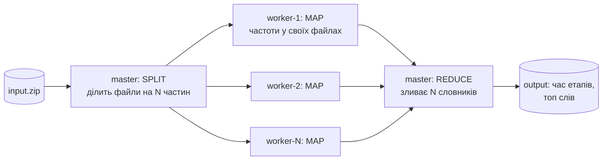
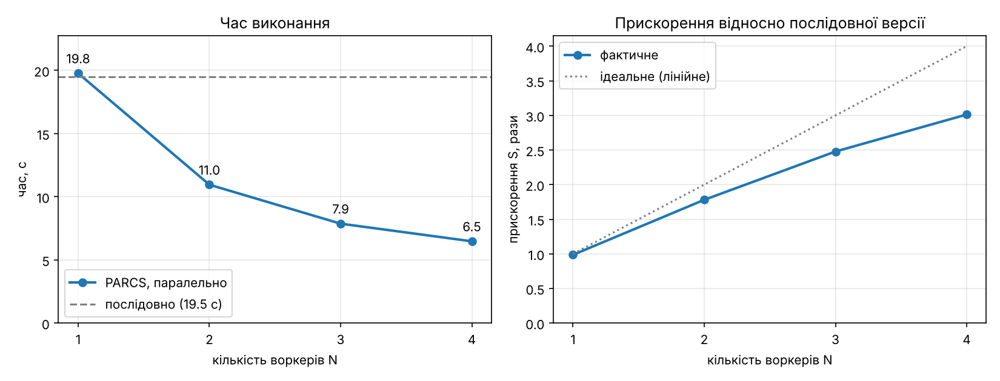

# PARCS-Python у Google Cloud: паралельний підрахунок частоти слів

Лабораторна робота 1 з курсу «Хмарні обчислення».
Виконав: Мекшаков Артемій Олексійович, група МІ-41.
Тема 4.1 «Паралельна обробка файлів (підрахунок частоти слів)».
Платформа: PARCS-Python ([Hummer12007/parcs-python](https://github.com/Hummer12007/parcs-python)), Google Compute Engine, 1 master + 4 workers.

**GitHub:** https://github.com/ЛОГІН/parcs-wordcount  <!-- заміни на своє посилання -->

---

## 1. Ідея алгоритму

На вході ZIP-архів з текстовими файлами (класичні книжки з Project Gutenberg). Потрібно порахувати, скільки разів кожне слово трапляється в усіх файлах разом. Частоти в різних файлах рахуються незалежно, а потім просто додаються, тому задача природно паралелиться за схемою **map-reduce**.



1. **SPLIT (master).** Master читає архів і розподіляє файли між N воркерами так, щоб обсяг тексту в кожного був майже однаковим. Використано жадібний алгоритм LPT: файли сортуються від найбільшого до найменшого, і кожен віддається найменш завантаженому воркеру. Це важливо, бо книжки сильно відрізняються за розміром (від 0,1 до 5 МБ), а загальний час визначає найповільніший воркер.
2. **MAP (workers, паралельно).** Master викликає `count_files` на всіх воркерах одночасно: проксі Pyro4 у PARCS асинхронні, кожен виклик одразу повертає future. Кожен воркер декодує UTF-8, переводить текст у нижній регістр, виділяє слова регулярним виразом (літери будь-якої мови, апостроф усередині слова: `don't`, `п'ять`) і рахує їх у словнику.
3. **REDUCE (master).** Master отримує N словників, зливає їх в один і будує топ-30 слів (окремо без службових слів на кшталт *the*, *and*).

Послідовна версія (`solver_seq.py`) робить те саме на master без воркерів і є базою для порівняння.

**Чого очікувати.** Час паралельної версії ≈ T<sub>split</sub> + T<sub>передачі</sub> + T<sub>map</sub>/N + T<sub>reduce</sub>. На N ділиться лише етап MAP; читання архіву, передача тексту мережею і злиття словників лишаються послідовними (закон Амдала), а зі зростанням N словників для злиття стає більше. Тому прискорення буде помітним, але меншим за ідеальне N разів. Вивід кожного job показує час усіх етапів і навантаження кожного воркера, тож це видно в цифрах.

**Серіалізація.** Для передачі даних між вузлами замість стандартного для Pyro4 serpent використано marshal: у Python 2.7 serpent передає байти як latin-1 unicode (ламає не-ASCII символи) і в рази повільніший на великих текстах і словниках.

| Файл | Призначення |
|---|---|
| `solver.py` | паралельна версія (PARCS job) |
| `solver_seq.py` | послідовна версія (PARCS job, рахує лише master) |
| `cloud/startup.sh` | startup-script для ВМ: запускає вузол PARCS у Docker |
| `scripts/download_books.py` | готує вхідний `input.zip` |
| `scripts/bench.sh` | автоматичний прогін: послідовно + N = 1..4 через REST API PARCS |
| `scripts/plot.py` | таблиця і графік з `results/results.csv` |
| `results/` | виміри, графік, виводи job-ів |

---

## 2. Проблеми застарілої платформи і як їх виправлено

| Проблема | Причина | Рішення |
|---|---|---|
| Команда `gcloud compute instances create-with-container` з офіційного гайду PARCS-Python не працює | Google вимкнув container startup agent (deprecated 21.07.2025, вимкнено 31.07.2026) | ВМ на Container-Optimized OS + startup-script [`cloud/startup.sh`](cloud/startup.sh), який запускає `docker run` (рекомендований Google шлях міграції) |
| Master не бачить воркерів, хоча контейнери працюють | Container-Optimized OS має власний firewall (iptables), що блокує вхідні з'єднання, а Pyro4 слухає випадкові порти | `iptables -A INPUT -p tcp -j ACCEPT` у startup-script; ззовні доступ і далі обмежує VPC firewall |
| Воркер реєструється з адресою `172.17.x.x` | контейнер у bridge-мережі Docker | `docker run --network host` |
| `SyntaxError` на f-рядках тощо | образ PARCS зібраний у 2018 році на Debian stretch і працює на Python 2.7 | код сумісний з Python 2.7 і 3 (`from __future__ import ...`, без f-рядків) |
| Спотворені не-ASCII слова, повільна передача даних | серіалізатор serpent у Python 2.7 перетворює bytes на latin-1 unicode і повільний | серіалізатор marshal |
| Якщо збирати образ самому: `apt-get update` падає з 404, `pip install` ставить несумісні версії | Debian stretch застарів, його репозиторії перенесено в архів; нові Flask і py-cpuinfo не підтримують Python 2.7, а PARCS читає ключ `cpuinfo['brand']`, якого в нових py-cpuinfo немає | startup-script сам збирає запасний образ на `python:2.7.18` із зафіксованими версіями (Pyro4 4.82, Flask 1.1.4, py-cpuinfo 5.0.0, netifaces 0.11.0, requests 2.27.1), якщо готовий образ недоступний |
| Оригінальний гайд відкриває всі порти всім в інтернеті | правило firewall `--rules=all --source-ranges=0.0.0.0/0` | ззовні відкрито лише `tcp:8080` і лише на master; трафік між ВМ дозволяє стандартне правило `default-allow-internal` |

---

## 3. Гайд: розгортання і запуск

Потрібен проєкт Google Cloud з увімкненим білінгом (free trial з кредитом $300 вистачає з великим запасом: весь кластер коштує близько $0,3 за годину). Усі команди виконуються в **Cloud Shell** (там уже є `gcloud`, `git`, `python3`).

### 3.1. Кластер: master + 4 workers

```bash
git clone https://github.com/ЛОГІН/parcs-wordcount && cd parcs-wordcount

gcloud config set project ID_ПРОЄКТУ
gcloud services enable compute.googleapis.com
gcloud config set compute/zone europe-north1-a

# ззовні відкриваємо лише веб-інтерфейс master (порт 8080)
gcloud compute firewall-rules create parcs-ui --network=default \
  --allow=tcp:8080 --target-tags=parcs-master --source-ranges=0.0.0.0/0

# master
gcloud compute instances create master --machine-type=n1-standard-1 \
  --image-family=cos-stable --image-project=cos-cloud --tags=parcs-master \
  --metadata-from-file=startup-script=cloud/startup.sh --metadata=parcs-args=master

# workers: внутрішній IP master передаємо через metadata
MASTER_IP=$(gcloud compute instances describe master --format='get(networkInterfaces[0].networkIP)')
gcloud compute instances create worker-1 worker-2 worker-3 worker-4 --machine-type=n1-standard-1 \
  --image-family=cos-stable --image-project=cos-cloud \
  --metadata-from-file=startup-script=cloud/startup.sh --metadata="parcs-args=worker $MASTER_IP"
```

Через 1–2 хвилини (поки ВМ завантажать Docker-образ) перевір кластер:

```bash
gcloud compute instances list
MASTER_EXT=$(gcloud compute instances describe master --format='get(networkInterfaces[0].accessConfigs[0].natIP)')
echo "PARCS: http://$MASTER_EXT:8080"
curl -s http://$MASTER_EXT:8080/api/worker | python3 -m json.tool | grep '"ip"'   # має бути 4 IP
```

### 3.2. Вхідні дані

```bash
python3 scripts/download_books.py   # ~60 книжок -> input.zip (~140 МБ тексту, архів ~50 МБ)
```

Без доступу до Gutenberg можна згенерувати текст: `python3 scripts/download_books.py --synthetic`. Щоб завантажити архів через браузер, скачай його з Cloud Shell (меню ⋮ → Download, шлях `parcs-wordcount/input.zip`) або запусти скрипт локально.

### 3.3. Запуск через веб-інтерфейс (демонстрація)

1. Відкрий `http://MASTER_EXT:8080` → **Workers**: видно 4 воркери з IP і CPU.
2. Щоб запустити на N воркерах, на сторінці Workers вимкни (Disable) зайвих.
3. **Add Job**: Solution File = `solver.py` (або `solver_seq.py` для послідовної версії), Input File = `input.zip` → Submit.
4. **Jobs** → коли з'явиться Duration, натисни **Output**: час кожного етапу (рядок `TOTAL`), навантаження кожного воркера, топ слів.

### 3.4. Виміри для таблиці і графіка

```bash
bash scripts/bench.sh $MASTER_EXT input.zip 3   # послідовно + N = 1..4, кожне по 3 рази (~5-10 хв)
python3 -m venv ~/venv && ~/venv/bin/pip install -q matplotlib
~/venv/bin/python scripts/plot.py
```

`bench.sh` робить те саме, що кнопки інтерфейсу (через REST API PARCS): вмикає потрібну кількість воркерів, запускає job, чекає на результат і записує час у `results/results.csv`. `plot.py` будує `results/plot.png` і вставляє таблицю в розділ 4 цього README.

### 3.5. Прибирання (щоб не витрачати кредит)

```bash
gcloud compute instances delete master worker-1 worker-2 worker-3 worker-4 --quiet
gcloud compute firewall-rules delete parcs-ui --quiet
```

### Якщо щось пішло не так

- **Воркерів немає у списку.** Зачекай ще хвилину. Логи: `gcloud compute ssh worker-1 --command "docker logs parcs 2>&1 | tail"` і `gcloud compute ssh worker-1 --command "sudo journalctl -u google-startup-scripts | tail"`.
- **`Quota 'IN_USE_ADDRESSES' exceeded`** (у free trial буває ліміт зовнішніх IP). Створи воркерів з `--no-address` і додай Cloud NAT, щоб вони могли завантажити Docker-образ:
  ```bash
  gcloud compute routers create parcs-router --network=default --region=europe-north1
  gcloud compute routers nats create parcs-nat --router=parcs-router --region=europe-north1 \
    --auto-allocate-nat-external-ips --nat-all-subnet-ip-ranges
  ```
- **`Quota 'CPUS' exceeded`.** Використовуй `n1-standard-1` (1 vCPU) і видали інші ВМ у проєкті.
- **Job завершився з помилкою.** Причина видно на сторінці Jobs; найчастіше на вхід подано не ZIP.

---

## 4. Результати

Конфігурація: 5 ВМ `n1-standard-1` (1 vCPU, 3,75 ГБ), зона `europe-north1-a`; вхід — ДОПИШИ: кількість файлів і МБ тексту з рядка `files:` у виводі job.

<!-- RESULTS:START -->
| Конфігурація | Воркерів | Час, с | Прискорення S = T<sub>seq</sub> / T<sub>N</sub> | Ефективність E = S / N |
|---|:---:|---:|---:|---:|
| послідовно (лише master) | - | … | 1.00 | - |
| паралельно (PARCS) | 1 | … | … | … |
| паралельно (PARCS) | 2 | … | … | … |
| паралельно (PARCS) | 3 | … | … | … |
| паралельно (PARCS) | 4 | … | … | … |
<!-- RESULTS:END -->



**Висновки.** ДОПИШИ після вимірів, наприклад: зі збільшенням кількості воркерів час MAP зменшується майже пропорційно; паралельна версія на 1 воркері трохи повільніша за послідовну через передачу тексту мережею; прискорення на 4 воркерах менше за 4 через послідовні етапи SPLIT і REDUCE (закон Амдала).
